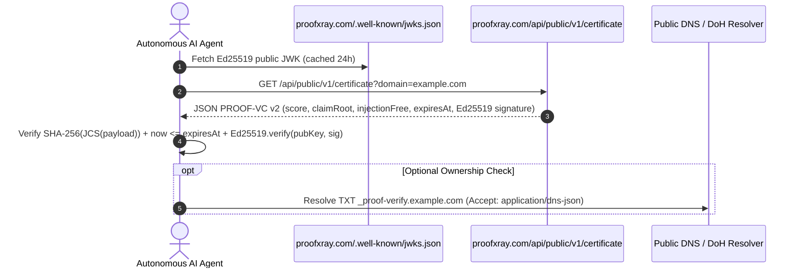

# PROOF-VC v2 DNS-01 Ownership Anchor & Offline Ed25519 Verification (RFC Draft v1.1)

> **Status:** RFC Draft / Implementation Proposal — `/.well-known/jwks.json` and `/api/public/v1/certificate` are live in PROOF-VC v2; DNS-01 ownership enforcement (`_proof-verify`) is optional and rolling out progressively.

## Abstract
The **PROOF-VC v2 Verification Protocol** defines an open, asymmetric, offline-verifiable trust specification for autonomous AI agents, LLM tool-calling engines, and web crawlers.

Unlike symmetric HMAC keys (which **must never** be published in DNS or shared with verifiers), PROOF-VC v2 separates **domain ownership proof** (DNS-01 TXT challenge) from **asymmetric cryptographic attestation** (**Ed25519 / EdDSA** signatures verified against PROOF's public key at `https://www.proofxray.com/.well-known/jwks.json`).

---

## 1. Public Root Key Discovery (RFC 7517 JWKS)

All verifiers (agents, CLIs, browsers, Edge Workers) fetch and cache PROOF's Ed25519 public key set once per day:

```http
GET https://www.proofxray.com/.well-known/jwks.json HTTP/1.1
Accept: application/json
```

---

## 2. Optional DNS-01 Ownership Anchor (`_proof-verify` TXT Record)

To bind a domain's certificate strictly to its verified owner (preventing third-party spoofing), a domain operator publishes a public TXT challenge at `_proof-verify.<domain>`:

```dns
_proof-verify.example.com.  300  IN  TXT  "proof-v2=challenge:<24-hex-token>;jwks=https://www.proofxray.com/.well-known/jwks.json;kid=proof-root-2026-11-24"
```

> **Security invariant:** No private key or symmetric HMAC secret is ever placed in DNS. The TXT record only proves DNS zone control (identical to ACME / Let's Encrypt DNS-01).

---

## 3. Autonomous Agent Verification Workflow (Offline-Verifiable)



### Verification Algorithm (Deterministic)
1. Canonicalize `attestation.payload` using RFC 8785 JCS (sorted keys, no whitespace).
2. Compute `digest = SHA-256(jcs(payload))` and assert `digest === attestation.digest`.
3. Assert `Date.now() <= Date.parse(payload.expiresAt)` and `payload.injectionFree === true`.
4. Verify `Ed25519.verify(publicJwk[kid], "proof-vc-v2\n" + digest, base64urlDecode(signature.value))`.
